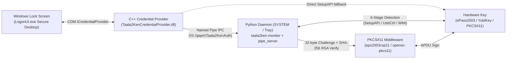

# TAALA-2KEN — Production Hardware USB Session Guard for Windows

**Proprietary Commercial Software Asset** — Native Windows LogonUI C++ COM Credential Provider (`ICredentialProvider`) + Python PKCS#11 / WMI / SetupAPI USB token enforcement daemon.

---

## Executive Overview & Value Proposition

TAALA-2KEN binds Windows workstation unlock, logon, and active desktop lock state to a physical cryptographic hardware key (**Feitian ePass2003**, **YubiKey**, **OpenSC-compatible CCID/PKCS#11 smartcards**, or enterprise USB tokens):
- **Physical Token Removal Auto-Lock:** Multi-stage detection pipeline (`SetupAPI` + kernel device notifications + `WMI`) monitors physical token presence every second with configurable grace windows and locks the desktop instantaneously on removal.
- **Secure Desktop Enforcement (LogonUI COM Provider):** Native C++ COM Credential Provider (`Taala2KenCredentialProvider.dll`) runs inside `LogonUI.exe` under the Windows Secure Desktop and communicates with the privileged daemon over a Named Pipe (`\\.\pipe\Taala2KenAuth`) plus direct SetupAPI fallback.
- **Asymmetric PKCS#11 Challenge-Response:** Enrollment extracts and stores only the token's public key (DER); unlock challenges generate 32-byte nonces signed strictly inside the hardware secure element using SHA-256 RSA PKCS#1.
- **Zero Cloud Dependency:** 100% air-gapped, deterministic local execution with audit trails and Windows Task Scheduler `SYSTEM` autostart XML provisioning.

---

## System Architecture



See [`ARCHITECTURE.md`](ARCHITECTURE.md), [`docs/architecture.md`](docs/architecture.md), [`docs/protocol.md`](docs/protocol.md), and [`docs/deployment.md`](docs/deployment.md) for deep technical specifications.

---

## Repository Structure

```text
TAALA-2KEN/
├── taala2ken/                    # Python background daemon, IPC server, tray UI & CLI
│   ├── __main__.py               # Package CLI entry point
│   ├── autostart.py              # Elevated Task Scheduler XML generator
│   ├── cli.py                    # Enrollment wizard & diagnostics
│   ├── config.py                 # Persistent fingerprint & DER public key config
│   ├── constants.py              # Detection keywords, pipe config & PKCS#11 paths
│   ├── detection/                # 6-stage SetupAPI / WMI deduplication pipeline
│   ├── lock.py                   # Workstation lock control
│   ├── monitor.py                # Presence watcher with grace period
│   ├── pipe_server.py            # Thread-safe Named Pipe JSON-RPC server
│   ├── pkcs11_auth.py            # PKCS#11 challenge generation & RSA signature verification
│   └── tray_app.py               # pystray system tray controller
├── credential_provider/          # Native C++ COM Credential Provider (LogonUI.exe)
│   ├── CMakeLists.txt
│   ├── Taala2KenProvider.cpp     # ICredentialProvider lifecycle
│   ├── Taala2KenCredential.cpp   # ICredentialProviderCredential tile & Logon serialization
│   ├── PipeServer.cpp            # Named Pipe IPC client
│   ├── SecureDesktopHelper.cpp   # SetupAPI Secure Desktop presence fallback
│   ├── build.bat                 # MSVC build script
│   └── sign_and_register.ps1     # Authenticode signing & registry installer
├── docs/                         # Detailed architecture, protocol, and deployment docs
├── tests/                        # Pytest verification suite
├── audit.md                      # Pre-acquisition security & due-diligence report
└── LICENSE.md                    # Proprietary Commercial Evaluation License
```

---

## Quick Start & Verification

### 1. Install Python Dependencies
```powershell
pip install -r requirements.txt
# Optional: copy runtime env template if overriding paths
copy .env.example .env
```

### 2. Run Automated Test Suite
```powershell
pytest -v
```

### 3. Enroll Hardware Token & Launch Monitor
```powershell
python -m taala2ken --setup
python -m taala2ken --debug
```

### 4. Build Native C++ Credential Provider (Visual Studio Developer Prompt)
```cmd
cd credential_provider
build.bat
```

---

## Commercial Licensing & M&A Evaluation

Copyright (c) 2026 Kushal (`@onlykushalll`). All Rights Reserved.

This software asset is **proprietary commercial intellectual property** available for commercial licensing, technical due diligence, and full IP acquisition (Contact: `creatormanager27@gmail.com`). See [`LICENSE.md`](LICENSE.md), [`TERMS.md`](TERMS.md), [`PRIVACY.md`](PRIVACY.md), and [`audit.md`](audit.md).

> **Third-Party Upstream Notice:** Python runtime packages, MSVC/Windows SDK interfaces, and external PKCS#11 middleware drivers (e.g., OpenSC / vendor CSP DLLs) remain subject to their respective upstream licenses.
